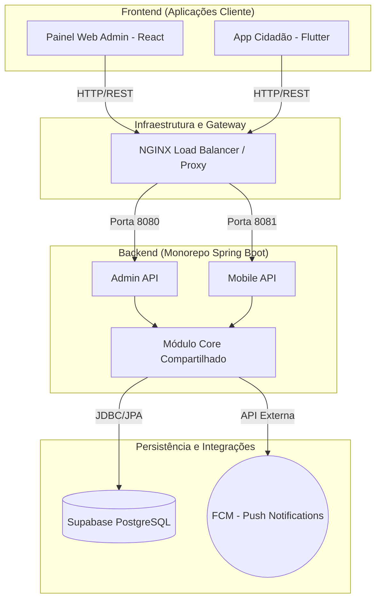
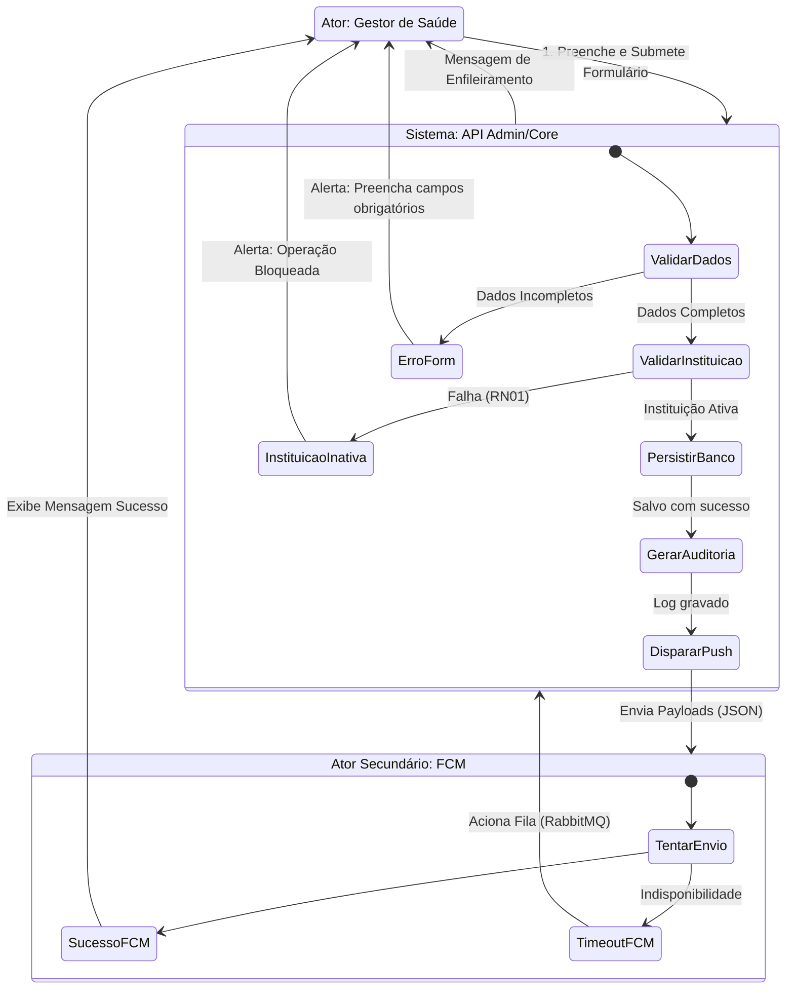
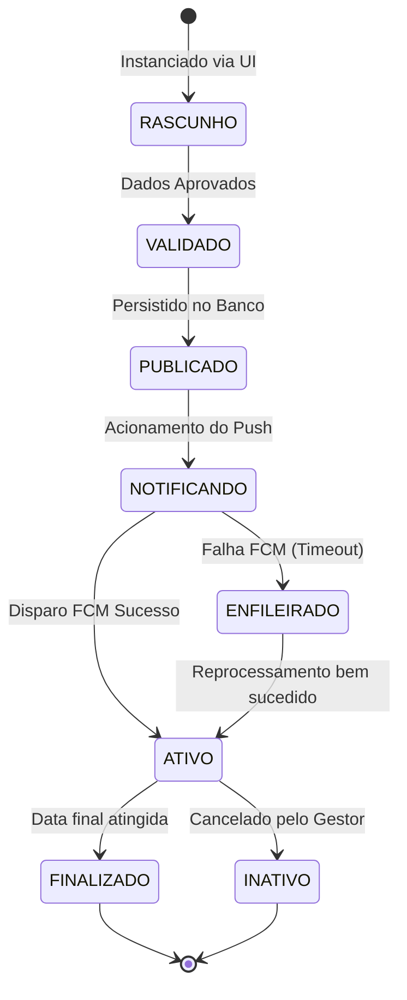

# INSTITUTO FEDERAL DE EDUCAÇÃO, CIÊNCIA E TECNOLOGIA
## DE SÃO PAULO - Campus Bragança Paulista
**Curso:** Análise e Desenvolvimento de Sistemas - ADS  
**Disciplina:** Qualidade de Software  
**Prof:** Wilson Vendramel  

**Integrantes do Grupo:**
* Luiz Henrique Gonçalves (BP: XXXXXX)
* Gustavo Tenório (BP: XXXXXX)
* Tsarco Gabriel Dias (BP: XXXXXX)
* Renan V. Koashi (BP: XXXXXX)
* Maycon Cabral (BP: XXXXXX)

---

# Trabalho 2 de Qualidade de Software - Projeto Conecta Vida

## Grupo 1: Especificação e Arquitetura do Software (2,0 pontos)

### 1- Especificação do Caso de Uso

**Quadro 1a - Descrição Textual do Caso de Uso**

| Caso de Uso: | **Publicar Alerta Crítico Epidemiológico** |
| :--- | :--- |
| **Descrição:** | Permite que o gestor de saúde publique um alerta de emergência geolocalizado, disparando instantaneamente uma notificação push para os cidadãos afetados na região. |
| **Ator Primário:** | Gestor de Saúde (Administrador) |
| **Ator(es) Secundário(s):** | Firebase Cloud Messaging (FCM), Supabase (PostgreSQL) |
| **Precondições:** | O Gestor de Saúde deve estar autenticado no Painel Web Administrativo e possuir permissões ativas de publicação. |
| **Fluxo Principal:** | 1) **O Gestor** seleciona a opção "Novo Alerta Crítico" no painel.<br>2) **O Sistema** apresenta o formulário de cadastro de alerta (Título, Descrição, Órgão, Localização).<br>3) **O Gestor** preenche os dados e submete.<br>4) **O Sistema** valida os dados obrigatórios e o vínculo com a Instituição.<br>5) **O Sistema** persiste o alerta no banco de dados, gera log de auditoria silencioso e aciona o motor do FCM.<br>6) **O Sistema** exibe a mensagem de sucesso ("Alerta disparado em tempo real"). |
| **Fluxo Alternativo (Passo 4):** | **4a. Instituição de Saúde Inativa:**<br>a) O Sistema detecta que o Órgão de Saúde vinculado está suspenso.<br>b) O Sistema exibe o alerta visual: "Operação bloqueada: Instituição inativa."<br>c) O Sistema aborta o disparo e mantém os dados na tela para correção. |
| **Fluxo de Exceção (Passo 5):** | **5a. Falha de Comunicação com o FCM:**<br>a) O Sistema persiste o alerta no banco, mas o FCM retorna erro de timeout/indisponibilidade.<br>b) O Sistema enfileira o disparo (RabbitMQ/assíncrono) para reprocessamento automático.<br>c) O Sistema avisa que o alerta foi salvo, mas o envio de push está em fila devido à lentidão da rede. |
| **Pós-condições:** | O Alerta é gravado na tabela `tb_comunicacao` e os dispositivos móveis da região recebem a notificação Push. Um registro inalterável é gerado em `tb_log_atividade`. |
| **Regras de Negócio Relacionadas:** | **RN01:** Todo alerta crítico deve obrigatoriamente estar associado a uma Instituição de Saúde oficial e ativa para prevenção de *fake news*.<br>**RN02:** A publicação ou alteração de qualquer alerta gera um registro automático de auditoria contendo ID do usuário, data/hora e tipo de ação.<br>**RN03:** Alertas de emergência possuem precedência no App Mobile, devendo interceptar a navegação do cidadão logo após o login. |

<br>

### 2- Diagrama de Classes (Camadas de Aplicação e Domínio)

```mermaid
classDiagram
    direction TB
    
    package "Camada de Aplicação (Service/Controller)" {
        class AlertaController {
            +criarAlerta(alertaDTO: ComunicacaoDTO): ResponseEntity
            +listarAlertas(): ResponseEntity
        }
        class CampanhaService {
            +publicarAlerta(dto: ComunicacaoDTO, gestorId: Long): Comunicacao
            -validarInstituicao(id: Long): boolean
        }
        class FcmService {
            +enviarNotificacaoPush(titulo: String, corpo: String, topico: String): void
        }
    }
    
    package "Camada de Domínio (Entidades)" {
        class Comunicacao {
            -id: Long
            -tipo: String
            -titulo: String
            -descricao: String
            -status: String
            -dataPostada: LocalDateTime
        }
        class InstituicaoSaude {
            -id: Long
            -nome: String
            -ativo: Boolean
        }
        class LogAtividade {
            -id: Long
            -acao: String
            -dataHora: LocalDateTime
        }
        class Usuario {
            -id: Long
            -email: String
            -permissao: String
        }
    }

    AlertaController ..> CampanhaService : Depende
    CampanhaService ..> FcmService : Aciona
    CampanhaService --> Comunicacao : Gerencia
    Comunicacao "N" --> "1" InstituicaoSaude : Vinculado a
    CampanhaService --> LogAtividade : Gera
    LogAtividade "N" --> "1" Usuario : Realizado por
```

<br>

### 3- Diagrama Arquitetural do Sistema



---

## Grupo 2: Projeto dos Casos de Teste, Execução e Análise (3,0 pontos)

### 4- Diagrama de Atividades e Grafo de Fluxo de Controle (GFC)

**Diagrama de Atividades (Swimlanes):**



**Quadro 2a: Caminhos Independentes do GFC**

| #Caminho | Caminho (Nós baseados nas decisões) | Nós Predicados |
| :--- | :--- | :--- |
| **C1** | Gestor -> Dados OK -> Instituição OK -> Banco -> FCM Sucesso -> Gestor | DadosValidos(V), Instituicao(V), FCM(V) |
| **C2** | Gestor -> Dados OK -> Instituição OK -> Banco -> FCM Timeout -> Fila -> Gestor | DadosValidos(V), Instituicao(V), FCM(F) |
| **C3** | Gestor -> Dados Incompletos -> ErroForm -> Gestor | DadosValidos(F) |
| **C4** | Gestor -> Dados OK -> Instituição Inativa -> Bloqueio -> Gestor | DadosValidos(V), Instituicao(F) |

<br>

### 5- Diagrama de Transição de Estados (Objeto: Comunicacao/Alerta)



**Quadro 2b: Sequências Independentes do GE**

| #Sequência | Sequência de transições | Estados envolvidos |
| :--- | :--- | :--- |
| **S1 (Fluxo Feliz)** | Criação -> Validação -> Publicação -> Notificação -> Ativo -> Fim | RASCUNHO, VALIDADO, PUBLICADO, NOTIFICANDO, ATIVO, FINALIZADO |
| **S2 (Falha Push)** | Criação -> Validação -> Publicação -> Notificação -> Enfileira -> Ativo | RASCUNHO, VALIDADO, PUBLICADO, NOTIFICANDO, ENFILEIRADO, ATIVO |
| **S3 (Cancelamento)** | Ativo -> Cancelamento Antecipado | ATIVO, INATIVO |

<br>

### 6- Planilha de Projeto dos Casos de Teste (Caixa-Preta)
A planilha de projeto abrangendo Partição de Equivalência (ID de usuário válido/inválido), Análise de Valor Limite (datas limites da campanha) e a matriz funcional do Teste Baseado em Modelo encontra-se anexada separadamente na plataforma da disciplina.

### 7- Evidência de Execução dos Testes de Sistema
**Links de Acesso:**
* [🔗 Link para a Planilha de Teste de Sistema no SharePoint/Google Drive]
* [🔗 Link para os Vídeos de Evidência de Execução (Testes passando no Painel React)]

---

## Grupo 3: Implementação, Execução dos Testes de Unidade e Análise (3,0 pontos)

### 8- Análise de Complexidade Ciclomática (GFC do Código)

Analisando o método mais complexo da camada *Service*: `publicarAlerta(ComunicacaoDTO dto, Long gestorId)`. O método contém:
1. Um `if` para verificar se os dados do DTO são nulos.
2. Um `if` para verificar o status ativo da instituição vinculada.
3. Um bloco `try-catch` para isolar falhas de comunicação com a API externa do Firebase (FCM).

**Cálculos via Lógica dos Predicados:**
* $V(G) = P + 1$
* $P$ (Nós Predicados de decisão) = 3
* **$V(G) = 3 + 1 = 4$**

O método gera um Grafo com **4 regiões**, possuindo complexidade ciclomática de 4, o que exige a implementação de, no mínimo, 4 casos de teste unitários para cobrir todos os caminhos estruturais (Caixa-Branca).

### 9- Implementação dos Testes de Unidade (Caixa-Branca)
A implementação utilizou **JUnit 5** e a biblioteca **Mockito** para mockar (isolar) a rede do FCM e o acesso ao banco de dados pelo repositório.
* [🔗 Link de acesso ao código dos testes (GitHub - CampanhaServiceTest.java)](#)

### 10- Relatório de Cobertura de Testes (JaCoCo)
A execução através do pipeline do Gradle com o plugin **JaCoCo** revelou uma cobertura satisfatória dos caminhos independentes do Service e Domain, validando se as RNs (Regras de Negócio) e a geração silenciosa de *Logs* de auditoria estão operando.
* [🔗 Link de acesso ao relatório HTML exportado do JaCoCo](#)

### 11- Engenharia Reversa (Diagrama de Classes: Produção vs Teste)

```mermaid
classDiagram
    package "Código de Produção (src/main/java)" {
        class CampanhaService {
            +publicarAlerta(dto, gestorId)
        }
        class ComunicacaoRepository {
            <<interface>>
        }
        class FcmService {
            +enviarNotificacaoPush(titulo, corpo)
        }
    }
    
    package "Código de Teste (src/test/java)" {
        class CampanhaServiceTest {
            -campanhaService: CampanhaService (InjectMocks)
            -comunicacaoRepository: ComunicacaoRepository (Mock)
            -fcmService: FcmService (Mock)
            +testPublicarAlertaSucesso()
            +testErroInstituicaoInativa()
            +testFalhaFCMDisparaFila()
            +testValidacaoDadosIncompletos()
        }
    }
    
    CampanhaServiceTest --> CampanhaService : Testa Comportamento
    CampanhaServiceTest ..> ComunicacaoRepository : Injeta Mock
    CampanhaServiceTest ..> FcmService : Injeta Mock
```

---

## Grupo 4: Resumo do Processo de Teste e Apresentação (2,0 pontos)

### 12- Resumo do Processo de Teste

**Quadro 4a - Resumo do Processo de Teste**

| Etapas | O que e como foi feito? |
| :--- | :--- |
| **Planejamento dos Testes** | **Abrangência:** Validar o core funcional "Publicar Alerta Crítico", regras de negócio e infraestrutura de push.<br>**Recursos Tecnológicos:** GitHub, VS Code, IntelliJ, Postman, JUnit, Firebase Simulator.<br>**Cronograma:** Conforme roadmap das Sprints acadêmicas.<br>**Responsáveis:** Toda a equipe (Luiz, Gustavo, Gabriel, Renan, Maycon). |
| **Projeto dos Casos de Teste (Caixa Preta)** | **Fase:** Teste de Sistema.<br>**Técnicas:** Partição de Equivalência (IDs válidos/inválidos), Análise de Valor Limite e Teste Baseado em Modelo (Grafo de Estados do fluxo do Alerta).<br>**Critérios:** Cobertura de Cenários Felizes e Tratamento de Exceções visuais no React. |
| **Projeto dos Casos de Teste (Caixa Branca)** | **Fase:** Teste de Unidade e de Integração de Classes (Java).<br>**Técnicas:** Fluxo de Controle e Complexidade Ciclomática.<br>**Critérios:** Atingir V(G)=4 para o método complexo, garantindo a cobertura dos caminhos estruturais (Mockito). |
| **Execução dos Testes** | **Técnica Funcional:** Execução manual guiada por planilhas através da interface React conectada à API rodando localmente na porta 8080 (PostgreSQL via Supabase).<br>**Técnica Estrutural:** Execução automatizada da suíte JUnit 5 no IntelliJ IDEA (`./gradlew test`). |
| **Análise dos Resultados** | **Técnica Funcional:** Comportamentos validados. Os modais de erro bloquearam requisições incorretas de forma defensiva antes da submissão pesada.<br>**Técnica Estrutural:** Relatório JaCoCo verificou a passagem do compilador por todas as áreas cruciais de segurança (geração de log obrigatória testada via `verify()`). |

### 13- Apresentação (Vídeo do Pitch)

A apresentação técnica abordando os três grupos de exercícios, arquitetura e detalhamento dos fluxos do Teste Baseado em Modelo está disponível no link abaixo. O vídeo contou com a participação de todos os integrantes, demonstrando as validações diretamente no ecossistema do Conecta Vida.

* [🔗 Link de acesso ao vídeo da apresentação no YouTube](#)

---
*© 2026 Conecta Vida. Documentação Técnica baseada nos requisitos da disciplina de Qualidade de Software.*
