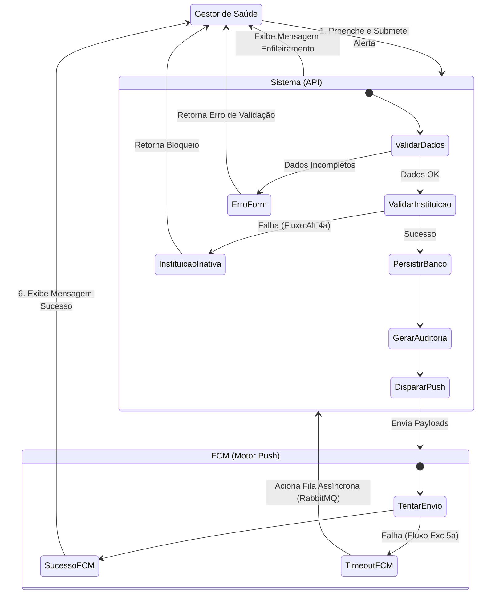
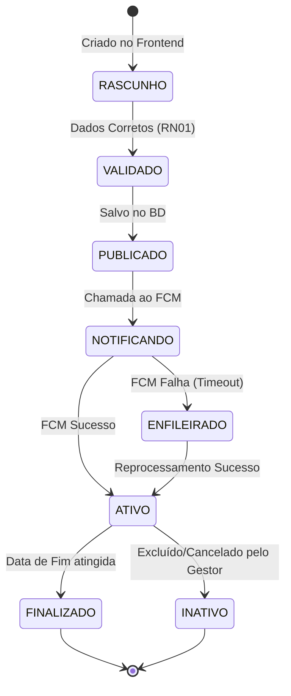

# INSTITUTO FEDERAL DE EDUCAÇÃO, CIÊNCIA E TECNOLOGIA
## DE SÃO PAULO - Campus Bragança Paulista
**Curso:** Análise e Desenvolvimento de Sistemas - ADS  
**Disciplina:** Qualidade de Software  
**Prof:** Wilson Vendramel  

**Integrantes do Grupo:**
* Luiz Henrique Gonçalves (BP: XXXXXX)
* Gustavo Tenório (BP: XXXXXX)
* Tsarco Gabriel Dias (BP: XXXXXX)
* Renan V. Koashi (BP: XXXXXX)
* Maycon Cabral (BP: XXXXXX)

---

# Trabalho 2 de Qualidade de Software - Projeto Conecta Vida

## Grupo 1: Especificação e Arquitetura do Software (2,0 pontos)

### 1- Especificação do Caso de Uso

**Quadro 1a - Descrição Textual do Caso de Uso**

| Caso de Uso: | Publicar Alerta Crítico Epidemiológico |
| :--- | :--- |
| **Descrição:** | Permite que o gestor de saúde publique um alerta de emergência geolocalizado, disparando instantaneamente uma notificação push para os cidadãos afetados na região. |
| **Ator Primário:** | Gestor de Saúde (Administrador) |
| **Ator(es) Secundário(s):** | Firebase Cloud Messaging (FCM), Supabase (PostgreSQL) |
| **Precondições:** | O Gestor de Saúde deve estar autenticado no Painel Web Administrativo e possuir permissões ativas de publicação. |
| **Fluxo Principal:** | 1) **O Gestor** seleciona a opção "Novo Alerta Crítico".<br>2) **O Sistema** apresenta o formulário de cadastro de alerta (Título, Descrição, Órgão, Localização).<br>3) **O Gestor** preenche os dados e submete.<br>4) **O Sistema** valida os dados obrigatórios e o vínculo com a Instituição.<br>5) **O Sistema** persiste o alerta no banco de dados, gera log de auditoria e aciona o motor do FCM.<br>6) **O Sistema** exibe mensagem de sucesso ("Alerta disparado"). |
| **Fluxo Alternativo:** | **4a. Instituição Inativa:**<br>a) O Sistema detecta que o Órgão de Saúde está suspenso.<br>b) O Sistema exibe o alerta: "Operação bloqueada: Instituição inativa."<br>c) O Sistema aborta o disparo e mantém os dados na tela. |
| **Fluxo de Exceção:** | **5a. Falha de Comunicação com o FCM:**<br>a) O Sistema persiste o alerta no banco, mas o FCM retorna timeout.<br>b) O Sistema enfileira o disparo (RabbitMQ/assíncrono) para reprocessamento.<br>c) O Sistema avisa que o envio de push está em fila devido à lentidão da rede. |
| **Pós-condições:** | O Alerta é gravado na tabela `comunicacoes` e dispositivos locais recebem notificação Push. Um registro é gerado em `logs_atividade`. |
| **Regras de Negócio:** | **RN01:** Todo alerta deve obrigatoriamente estar associado a uma `InstituicaoSaude` ativa para evitar fake news.<br>**RN02:** A publicação gera um log silencioso obrigatório contendo ID do usuário, data/hora e ação.<br>**RN03:** Alertas críticos têm precedência no aplicativo móvel, interceptando a tela inicial no login. |

<br>

### 2- Diagrama de Classes (Camadas de Aplicação e Domínio)

```mermaid
classDiagram
    direction TB
    
    package "Camada de Aplicação (Service/Controller)" {
        class AlertaController {
            +criarAlerta(alertaDTO: ComunicacaoDTO): ResponseEntity
            +listarAlertas(): ResponseEntity
        }
        class CampanhaService {
            +publicarAlerta(dto: ComunicacaoDTO, gestorId: Long): Comunicacao
            -validarInstituicao(id: Long): boolean
        }
        class FcmService {
            +enviarNotificacaoPush(titulo: String, corpo: String, topico: String): void
        }
    }
    
    package "Camada de Domínio (Entidades)" {
        class Comunicacao {
            -id: Long
            -tipo: String
            -titulo: String
            -descricao: String
            -status: String
            -dataPostada: LocalDateTime
        }
        class InstituicaoSaude {
            -id: Long
            -nome: String
            -ativo: Boolean
        }
        class LogAtividade {
            -id: Long
            -acao: String
            -dataHora: LocalDateTime
        }
        class Usuario {
            -id: Long
            -email: String
            -permissao: String
        }
    }

    AlertaController ..> CampanhaService : Depende
    CampanhaService ..> FcmService : Aciona
    CampanhaService --> Comunicacao : Gerencia
    Comunicacao "N" --> "1" InstituicaoSaude : Vinculado a
    CampanhaService --> LogAtividade : Gera
    LogAtividade "N" --> "1" Usuario : Realizado por
```

<br>

### 3- Diagrama Arquitetural do Sistema


---

## Grupo 2: Projeto dos Casos de Teste, Execução e Análise (3,0 pontos)

### 4- Diagrama de Atividades e Grafo de Fluxo de Controle (GFC)

**Diagrama de Atividades (Swimlanes):**



**Quadro 2a: Caminhos Independentes do GFC**

| #Caminho | Caminho (Nós baseados nas decisões) | Nós Predicados |
| :--- | :--- | :--- |
| **C1** | Gestor -> Dados OK -> Instituição OK -> Banco -> FCM Sucesso -> Gestor | Dados Validos (V), Instituicao (V), FCM (V) |
| **C2** | Gestor -> Dados OK -> Instituição OK -> Banco -> FCM Timeout -> Fila -> Gestor | Dados Validos (V), Instituicao (V), FCM (F) |
| **C3** | Gestor -> Dados Incompletos -> Erro -> Gestor | Dados Validos (F) |
| **C4** | Gestor -> Dados OK -> Instituição Inativa -> Bloqueio -> Gestor | Dados Validos (V), Instituicao (F) |

<br>

### 5- Diagrama de Transição de Estados da classe `Comunicacao` (Alerta)



**Quadro 2b: Sequências Independentes do GE**

| #Sequência | Sequência de transições | Estados envolvidos |
| :--- | :--- | :--- |
| **S1** | Criação -> Validação -> Publicação -> Notificação -> Ativo -> Fim | RASCUNHO, VALIDADO, PUBLICADO, NOTIFICANDO, ATIVO, FINALIZADO |
| **S2** | Criação -> Validação -> Publicação -> Notificação Falha -> Reprocessa | RASCUNHO, VALIDADO, PUBLICADO, NOTIFICANDO, ENFILEIRADO, ATIVO |
| **S3** | Ativo -> Cancelamento de Emergência | ATIVO, INATIVO |

<br>

### 6- Planilha de Projeto dos Casos de Teste (Caixa-Preta)
*A planilha detalhada contendo Partição de Equivalência, Valor Limite e matriz TBM encontra-se anexada na plataforma Teams.*

### 7- Evidência de Execução dos Testes de Sistema
**Links para os vídeos/evidências:**
* [🔗 Link da Planilha de Teste de Sistema no SharePoint/Google Drive]
* [🔗 Link do Vídeo demonstrando a execução do Cadastro e Tratamento de Erros]

---

## Grupo 3: Implementação, Execução dos Testes de Unidade e Análise (3,0 pontos)

### 8- Análise de Complexidade Ciclomática (GFC do Código)

Analisando o método `publicarAlerta(ComunicacaoDTO dto, Long gestorId)` no `CampanhaService`:

*O método possui 3 estruturas de decisão (`if` validação dto nulo, `if` instituição inativa, `try-catch` disparo FCM).*

**Cálculo Matemático:**
* $V(G) = P + 1$
* $P$ (Nós Predicados) = 3
* $V(G) = 3 + 1 = 4$

**Resultado:** O método possui complexidade ciclomática de **4**, resultando em **4 regiões** no grafo e exigindo 4 casos de teste de caminho básico.

### 9- Implementação dos Testes de Unidade (Caixa-Branca)
Os testes foram implementados utilizando **JUnit 5** e **Mockito** (para *Mocks* do `FcmService` e `InstituicaoSaudeRepository`).
* [🔗 Acessar Código Fonte dos Testes Unitários no GitHub (CampanhaServiceTest.java)](https://github.com/LuizHenriqueGon/Conecta-Vida-Backend/tree/main/admin-api/src/test/java/br/edu/ifsp/conectaavida/admin/service)

### 10- Relatório de Cobertura de Testes (JaCoCo)
Os testes estruturais foram executados, garantindo a passagem por todas as arestas dos métodos das camadas de *Service* e *Domain*.
* [🔗 Link para o Relatório HTML do JaCoCo exportado]

### 11- Engenharia Reversa (Diagrama de Classes de Produção vs Teste)

```mermaid
classDiagram
    package "src/main/java (Produção)" {
        class CampanhaService {
            +publicarAlerta()
        }
        class ComunicacaoRepository {
            <<interface>>
        }
        class FcmService {
            +enviarNotificacaoPush()
        }
    }
    
    package "src/test/java (Testes)" {
        class CampanhaServiceTest {
            -campanhaService: CampanhaService (InjectMocks)
            -comunicacaoRepository: ComunicacaoRepository (Mock)
            -fcmService: FcmService (Mock)
            +devePublicarAlertaComSucesso()
            +deveLancarExcecaoInstituicaoInativa()
            +deveEnfileirarQuandoFcmFalhar()
        }
    }
    
    CampanhaServiceTest --> CampanhaService : Testa
    CampanhaServiceTest ..> ComunicacaoRepository : Mocka
    CampanhaServiceTest ..> FcmService : Mocka
```

---

## Grupo 4: Resumo do Processo de Teste e Apresentação (2,0 pontos)

### 12- Resumo do Processo de Teste

**Quadro 4a - Resumo do Processo de Teste**

| Etapas | O que e como foi feito? |
| :--- | :--- |
| **Planejamento dos Testes** | **Abrangência:** Validar o caso de uso "Publicar Alerta Crítico", regras de segurança e persistência.<br>**Recursos:** GitHub, VS Code, IntelliJ, Postman, JUnit, Firebase Simulator.<br>**Técnica:** Funcional Caixa Preta e Estrutural Caixa Branca.<br>**Responsáveis:** Maycon (Segurança), Luiz (Backend/Testes de Unidade), Renan e Gustavo (Regras de Negócio). |
| **Projeto dos Casos de Teste** | **Fase:** Teste de Sistema<br>**Técnicas:** Partição de Equivalência (IDs válidos/inválidos), Teste Baseado em Modelo (Grafo de Estados do Alerta).<br>**Critérios:** Cobertura de Cenários, Caminhos e Transições de Alertas (Rascunho -> Ativo).<br>**Fase:** Teste de Unidade (Caixa Branca)<br>**Técnicas:** Fluxo de Controle, Complexidade Ciclomática ($V(G)=4$). |
| **Execução dos Testes** | **Técnica Caixa Preta:** Via Painel Web React (Interface) usando o Postman para interceptar requisições. O backend rodou localmente conectado ao Supabase.<br>**Técnica Caixa Branca:** Execução da suíte JUnit 5 através do Gradle (`gradlew test`), utilizando Mockito para isolar a rede do Firebase. |
| **Análise dos Resultados** | **Técnica Caixa Preta:** Validação de comportamento frente a erros forçados. Os alertas visuais de falha renderizaram perfeitamente no React.<br>**Técnica Caixa Branca:** Utilização do plugin JaCoCo. Verificou-se que 100% dos caminhos independentes do método complexo foram percorridos, garantindo que logs defensivos sejam gerados. |

### 13- Apresentação Final (Vídeo)

A apresentação em formato *Pitch*, conduzida por todos os integrantes do grupo e explicando a arquitetura e testes do Conecta Vida, está disponibilizada abaixo:

* [🔗 Link de acesso ao vídeo da apresentação no YouTube]

---
*© 2026 Conecta Vida. Documentação Técnica baseada nos requisitos da disciplina de Qualidade de Software.*